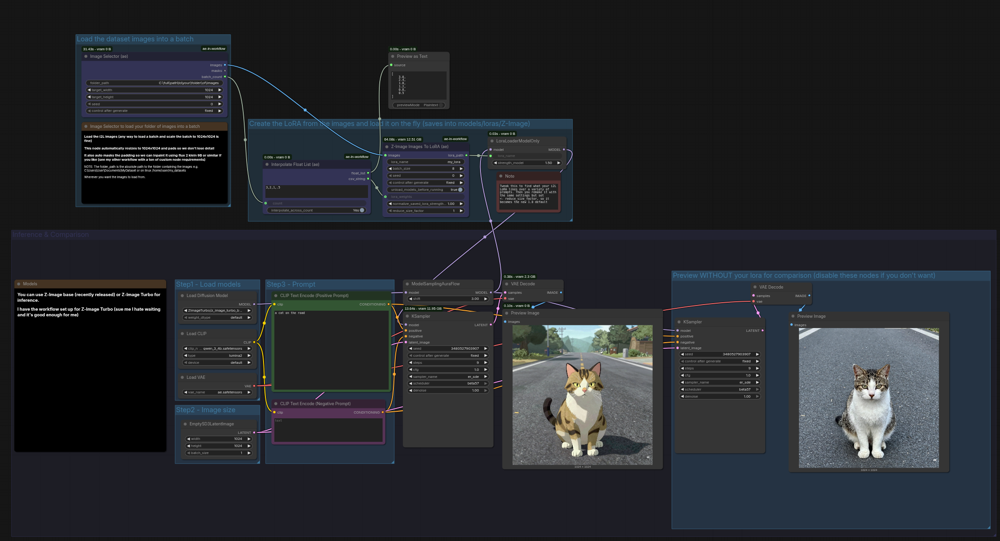

# In-workflow Nodes for ComfyUI
[](https://github.com/by-ae)
[](https://github.com/by-ae)
[](https://github.com/by-ae/ae-in-workflow/actions/workflows/ci.yml)
[](https://opensource.org/licenses/MIT)

A collection of interactive nodes that provide convenient workflow tools for ComfyUI.



## NOTE:
```
I'm not sure if this is a normal way to do things, but rather than validation I simply use seed to trigger running the node again with the same inputs if I require.
Most of the time you will want to set these to Fixed for the node to run once and not again unless the inputs change.
But if you need them to proc again, just change the seed value and it will run again with the same inputs.
```

## 🎯 NODES SO FAR:

**Z-Image - Images To LoRA**: Brings DiffSynth-Studio's Z-Image i2L pipeline into ComfyUI as a convenient single-node solution for converting image batches to LoRA models.

**Image Selector**: Interactive image selection from folders with thumbnail grid view, sorting, folder navigation, and asynchronous loading for enormous folders.

**Crop Image Batch to Mask Bounds**: Intelligent cropping of image batches based on mask boundaries with consistent output dimensions.

**Interactive Pose Editor**: Pose manipulation with multi-person support, hierarchical editing, undo/redo, and caching.

## 🔧 OTHER UTILS

**Interpolate Float List**: Process and interpolate comma-separated float lists.

**Crop Image Batch to Mask Bounds**: Crop each image-mask pair, or the whole batch, to mask bounds. Optional width and height expand the canvas before cropping.

## 🚀 Key Features

### ✨ Z-Image - Images To LoRA
- **🎯 Convenient LoRA Creation**: Turn image batches into LoRA models using DiffSynth-Studio's pipeline
- **🧠 Memory Efficient**: Includes VRAM management optimizations
- **📦 Batch Processing**: Handle large image sets with configurable batch sizes
- **🔢 Auto-Versioning**: Automatic version numbering to avoid overwrites
- **🔗 Direct Integration**: Accepts image batch input and outputs path that feeds directly into LoraLoaderModelOnly (you don't even need to refresh, it's single pass)

### 🎭 Professional Pose Editing
- **⚡ One-Click Editing**: Click any keypoint and drag to move it instantly
- **🎯 Smart Person Selection**: Automatically selects the person closest to your cursor
- **👥 Multi-Person Scenes**: Add, remove, and manage multiple people in one scene
- **🔄 Pose Manipulation**: Move, rotate, and scale entire poses or individual limbs
- **🦴 Limb Controls**: Move keypoints with or without their "children" (connected joints)
- **🔄 Flip & Turn**: Mirror poses horizontally or rotate them 180°
- **✨ Auto-Fix Missing Keypoints**: Estimates missing joints using T-pose proportions
- **📐 Smart Spacing**: Automatically prevents people from overlapping
- **🔄 Duplicate & Clone**: Copy poses for creating variations quickly
- **🎬 Animation Chains**: Link multiple nodes for frame-by-frame stop-motion style animation
- **💾 Smart Caching**: Remembers your edits for instant loading next time
- **🖥️ Window Memory**: Remembers window position and size between sessions
- **🌐 Cross-Platform**: Works identically on Windows, macOS, and Linux
- **🎨 T-Pose Templates**: Start fresh with clean T-poses when no input provided

## 📦 Installation

### Quick Start (ComfyUI Manager - Recommended)
1. Open ComfyUI Manager in ComfyUI
2. Click "Install via Git URL"
3. Paste: `https://github.com/by-ae/ae-in-workflow.git`
4. Click "Install" and restart ComfyUI
5. For Z-Image functionality, install DiffSynth-Studio (see below)

### For Z-Image - Images To LoRA Node
This node requires DiffSynth-Studio. The other nodes work without it.

**Installation steps:**
1. Activate your ComfyUI Python environment
2. Run these commands:
   ```bash
   git clone https://github.com/modelscope/DiffSynth-Studio.git
   cd DiffSynth-Studio
   pip install -e .
   ```

**Environment-specific examples:**

For portable ComfyUI (python_embedded):
```bash
git clone https://github.com/modelscope/DiffSynth-Studio.git
cd DiffSynth-Studio
C:\path\to\ComfyUI_Portable\python_embedded\python.exe -m pip install -e .
```

For .venv ComfyUI (Windows):
```cmd
C:\path\to\ComfyUI\.venv\Scripts\activate.bat
git clone https://github.com/modelscope/DiffSynth-Studio.git
cd DiffSynth-Studio
pip install -e .
```

For .venv ComfyUI (Linux/Mac):
```bash
source /path/to/ComfyUI/.venv/bin/activate
git clone https://github.com/modelscope/DiffSynth-Studio.git
cd DiffSynth-Studio
pip install -e .
```

For conda/mamba:
```bash
conda activate your_comfyui_env
git clone https://github.com/modelscope/DiffSynth-Studio.git
cd DiffSynth-Studio
pip install -e .
```

### Manual Installation (Alternative)
1. Clone this repository into your ComfyUI `custom_nodes` directory:
   ```bash
   cd ComfyUI/custom_nodes
   git clone https://github.com/by-ae/ae-in-workflow.git
   cd ae-in-workflow
   pip install -r requirements.txt
   ```
2. Restart ComfyUI

## 🔧 Requirements

Automatically installed by `pip install -r requirements.txt`:

```txt
pygame>=2.0.0          # Interactive pose editor UI
torch>=1.9.0           # PyTorch for ML operations
numpy>=1.19.0          # Numerical computing
Pillow>=8.0.0          # Image processing
safetensors>=0.4.0     # Safe tensor serialization
screeninfo>=0.8.0      # Optional: improves window positioning
```

**Optional:** For Z-Image - Images To LoRA, install [DiffSynth-Studio](https://github.com/modelscope/DiffSynth-Studio) separately (see installation steps above).

## 🎨 Nodes

### Z-Image - Images To LoRA (ae)

**Category:** `ae-in-workflow`

Convert image batches to LoRA models using DiffSynth-Studio's pipeline, with direct integration for ComfyUI workflows.

Convert images to LoRA (Low-Rank Adaptation) using the Z-Image pipeline from DiffSynth-Studio. This node processes batches of images and generates LoRA files that can be used with LoraLoaderModelOnly nodes.

**Powered by:** [DiffSynth-Studio](https://github.com/modelscope/DiffSynth-Studio)

#### Key Features:
- **🎯 LoRA Creation**: Convert image batches to LoRA models using DiffSynth-Studio's pipeline
- **⚖️ Weighted Averaging**: Apply custom weights to each image for fine-tuned LoRA generation
- **🎚️ Strength Control**: Adjust overall LoRA strength with multiplier factor
- **📏 Size Reduction**: Compress LoRA size by averaging groups of similar images
- **🧠 Memory Efficient**: Includes VRAM management with bfloat16 precision
- **📦 Batch Processing**: Handle large image sets with configurable batch sizes
- **🔢 Auto-Versioning**: Automatic version numbering to avoid overwrites
- **🔗 Direct Integration**: Output paths work seamlessly with LoraLoaderModelOnly

#### Inputs:
- **images** (required): Batch of images as tensor (shape: B×H×W×3)
- **lora_name** (required): Dataset name for the LoRA (default: "my_lora"). Letters and digits in any language are kept, spaces become underscores, and other characters are removed. A name with no letters or numbers stops the node
- **batch_size** (optional): Images to process simultaneously (default: 8, higher = faster but more VRAM)
- **lora_weights** (optional): Comma-separated weights for each image (e.g., "1.0,2.0,0.5"). Leave empty for equal weighting. A token that is not a finite number stops the node and names the token
- **normalize_saved_lora_strength_to** (optional): Strength stored in the saved LoRA (default: 1.0). If a result only looked right at loader strength 1.75, set this to 1.75 and loader strength 1.0 matches that
- **reduce_size_factor** (optional): Batch size for averaging LoRAs (default: 1, higher = smaller final LoRA by averaging groups)
- **unload_models_before_running** (optional): Unload other ComfyUI models before running (default: True). Set this to False to leave them loaded
- **seed** (optional): Change to force re-execution with same inputs (default: 0)

#### Outputs:
- **lora_path**: Path relative to the LoRA folder (e.g., "Z-Image/ae/z-image_my_lora_v000.safetensors")

#### Usage Notes:
- The file is saved in the first LoRA folder ComfyUI has configured, at `Z-Image/ae/z-image_<name>_vXXX.safetensors`. On a default ComfyUI layout that folder is `models/loras/`
- Connect the output directly to LoraLoaderModelOnly "lora_name" input
- Requires DiffSynth-Studio (install via instructions at https://github.com/modelscope/DiffSynth-Studio)

### Image Selector (ae)

**Category:** `ae-in-workflow`

**🎯 INTERACTIVE IMAGE BROWSER**: Browse and select images from folders using an intuitive thumbnail grid interface with folder navigation and asynchronous loading. Perfect for curating datasets before processing with other nodes.

An interactive image selector that displays images from a folder in a scrollable grid view. Click to select/deselect images, navigate between folders instantly, and handle enormous folders without performance issues thanks to asynchronous loading.

#### Key Features:
- **🖼️ Thumbnail Grid View**: Visual browsing of images in folders
- **📁 Folder Navigation**: Tree panel for browsing subdirectories and parent folders
- **👆 Click Selection**: Click thumbnails to select/deselect (maintains order)
- **📜 Smooth Scrolling**: Navigate large image collections with optimized performance
- **⚡ Asynchronous Loading**: Handles enormous folders without freezing UI
- **📐 Smart Resizing**: Automatic aspect-ratio-preserving resizing with custom padding
- **🎨 Transparency Support**: Handles images with alpha channels
- **📦 Batch Output**: Ready-to-use IMAGE tensors for ComfyUI workflows

#### Controls:
```
Left Click: Select/deselect image or navigate folders
Ctrl+A: Select/deselect all images
Ctrl+S: Cycle through sort modes (Name/Size/Modified/Created/Dimensions)
Ctrl+D: Toggle sort direction (ascending/descending)
ESC/ENTER: Finish selection and close
Mouse Wheel: Scroll through images (right) or folders (left)
```

#### Inputs:
- **folder_path** (required): Path to a folder of images, or a folder to start browsing from
- **target_width** (optional): Output width in pixels (default: 0). 0 leaves width automatic
- **target_height** (optional): Output height in pixels (default: 0). 0 leaves height automatic
- **padding_color** (optional): Hex color used to pad images that do not fill the canvas, `#RGB` or `#RRGGBB` (default: `#000000`)
- **seed** (optional): Change to force re-execution with same inputs (default: 0)

#### Outputs:
- **images**: Selected images as batched tensor (ComfyUI IMAGE format)
- **masks**: Alpha masks for images with transparency
- **batch_count**: Number of images in the batch

#### Usage Notes:
- **Supported Formats**: PNG, JPG, JPEG, BMP, TIF, TIFF, and WebP
- **Orientation**: Images are turned upright from their EXIF orientation tag before the thumbnail grid and the output batch are built. Images with no orientation tag are left as stored
- **Asynchronous Loading**: Folders load in background with loading indicator - no UI freezing even with 1000+ images
- **Lazy Loading**: Images are loaded on-demand with intelligent caching for smooth scrolling
- **Memory Management**: Only visible images are kept in memory with automatic cleanup
- **Folder Navigation**: Tree panel allows instant navigation between folders with async loading
- **Performance**: Handles enormous folders efficiently with 1-image-per-frame loading limits
- **Sizing**: With both targets at 0, the canvas follows the largest selected image and the long side is capped at 2048. Set both width and height to use that exact canvas. Set only one of them and the other side follows that image's aspect ratio
- **Image Processing**: Each selected image is scaled to fit inside the canvas, keeping its aspect ratio, then padded with `padding_color`. Palette, grayscale, 1-bit, and other modes are converted to RGB first, so indexed colors stay correct
- **Masks**: An image with an alpha channel (RGBA, LA, or a transparent palette image) outputs that alpha. Other images get a fully opaque mask. Padded pixels are 0 in the mask
- **Sorting**: Multiple sort options (Name, Size, Modified date, Created date, Dimensions) with persistent settings
- **Selection**: Click thumbnails to select/deselect, Ctrl+A to select/deselect all
- **UI Enhancements**: All text has black outlines for readability on dark backgrounds
- **Batch Output**: Selection order is preserved in the output tensor


### Crop Image Batch to Mask Bounds (ae)

**Category:** `ae-in-workflow`

**✂️ Intelligent Mask-Based Cropping**: Crop image batches to mask boundaries with options for individual or combined cropping, ensuring consistent output dimensions.

This node crops images based on mask boundaries, with two modes for different use cases. Perfect for preparing masked objects or scenes for further processing while maintaining alignment between images and masks.

#### Key Features:
- **🎯 Mask-Based Cropping**: Automatically finds and crops to mask boundaries
- **🔄 Two Cropping Modes**: Individual object cropping or combined scene cropping
- **📐 Consistent Dimensions**: All outputs have matching dimensions with intelligent scaling and padding
- **🎨 Custom Padding**: Choose padding color for consistent backgrounds
- **🔄 Mask Alignment**: Output masks are cropped/resized identically to maintain perfect alignment

#### Modes:
- **mask_for_each**: Crop each image to its individual mask bounds, scale UP to match combined bounds (maintaining aspect ratio), pad as needed
- **sum_of_masks**: Crop all images to the combined bounds of all masks (scene-level cropping)

#### Inputs:
- **images** (required): Batch of images to crop (B,H,W,C)
- **masks** (required): Corresponding masks defining crop boundaries (B,H,W)
- **invert_mask** (optional): Invert masks before finding bounds (default: False)
- **mode** (optional): Cropping mode - "mask_for_each" or "sum_of_masks" (default: "mask_for_each")
- **padding_color** (optional): Hex color for padding areas (default: "#000000")
- **optional_padding** (optional): Extra padding pixels around cropped areas (default: 0)
- **optional_new_width** (optional): Output width in pixels (default: 0). In `mask_for_each`, 0 uses the widest crop and any other value is the exact canvas width. In `sum_of_masks`, a value above 0 expands the frame to at least this width and skips the mask crop, returning that whole frame
- **optional_new_height** (optional): Output height in pixels (default: 0). In `mask_for_each`, 0 uses the tallest crop and any other value is the exact canvas height. In `sum_of_masks`, a value above 0 pads the image to at least this height and the mask crop still runs, so an interior mask stays the same size. The extra height remains when the crop reaches it (an empty mask, or `optional_padding` at the bottom edge). If width is also above 0, the mask crop is skipped and the padded frame is returned
- **color_fill_mask** (optional): When on (default), pixels below mask value 0.5 are replaced with `padding_color` before the crop. With `invert_mask` on, pixels above 0.5 are filled instead

#### Outputs:
- **images**: Cropped and resized images with consistent dimensions
- **masks**: Corresponding masks cropped, resized, and padded to match images

#### Usage Notes:
- **Bounds**: The crop keeps every pixel where the mask is above 0.5, including a mask that is a single row, column, or pixel. `optional_padding` adds that many pixels on each side and stops at the image edge
- **Output size**: In `mask_for_each`, set one side to force that canvas side and leave the other at 0 to keep the crop's own size. The crop is scaled to fit inside that canvas and padded. Both sides at 0 use the largest crop in the batch. Images need 3 color channels; a different count stops the node with an error
- **Empty Masks**: An empty mask keeps the full frame
- **Aspect Ratio**: In `mask_for_each`, each crop is scaled to share one canvas while keeping its proportions, then padded
- **Batch Consistency**: All images in the batch end up with identical dimensions
- **Mask Alignment**: Output masks are cropped and resized with their images
- **Hex color**: `padding_color` accepts `#RGB` and `#RRGGBB`. Anything else stops the node with an error

### Interactive Pose Editor (ae)

**Category:** `ae-in-workflow`

**🎭 Interactive Pose Editor**: Pose manipulation with multi-person support, hierarchical editing, undo/redo, and caching.

An interactive pose editor that allows users to manipulate OpenPose keypoints with full control.

#### Inputs:
- **POSE_KEYPOINT_optional** (optional): Pose data in the 18-keypoint layout this editor uses. Leave it unconnected to start from a T-pose
  - A single frame dict is accepted, or a list of frames: `[{"people": [{"pose_keypoints_2d": [x1, y1, conf1, x2, y2, conf2, ...]}]}]`
  - Keypoint order: nose, neck, right shoulder, right elbow, right wrist, left shoulder, left elbow, left wrist, right hip, right knee, right ankle, left hip, left knee, left ankle, right eye, left eye, right ear, left ear
  - Confidence `0.0` means missing. A value above `0.0` is visible, and the point must also be somewhere other than `(0, 0)`
- **padding** (optional): Padding in pixels around the pose in the output image (default: 128)
- **seed** (optional): Change this to open the editor again with the same pose (default: 0)
- **reset_cached_window_position** (optional): Open the window at x=20, y=20, size 1024×1024 (default: False). Leave it off to reuse the saved window position and size

#### Outputs:
- **image**: Rendered pose as tensor (1, H, W, 3) cropped to pose bounds with padding
- **edited_pose_data**: Updated pose data in the same format as the input

#### Key Features:
- **Smart Caching**: Automatically caches your edits based on input pose hash - next time you load the same pose, your edits are restored
- **Multi-Person Support**: Add (Ctrl+N), duplicate (Ctrl+D), delete (Ctrl+X) people in the scene
- **Auto-Fix**: Press Ctrl+F to estimate missing keypoints using T-pose proportions
- **Undo/Redo**: Full undo/redo support (Ctrl+Z, Ctrl+Shift+Z/Ctrl+Y)
- **Reset**: Press Ctrl+O to reset to original input pose
- **Window Memory**: Window position and size are remembered between sessions

#### Usage Notes:
- **Initial Input**: Connect pose data from an OpenPose preprocessor or ControlNet, or leave the input empty for a T-pose
- **Validation**: Malformed data (no people, a missing `pose_keypoints_2d`, or a length not divisible by 3) raises an error and does not open the window
- **Numeric types**: Keypoint values may be plain numbers, NumPy scalars, a NumPy array (flat or rows of x, y, confidence), or a PyTorch tensor of numbers. The editor opens on those instead of returning a black image. Ctrl+O decodes the original input the same way, so a reset can be saved
- **Keypoints**: 18 points in the order listed above, the layout used by the common ControlNet OpenPose preprocessor
- **Confidence Values**: Only keypoints with confidence above 0.0 and a non-zero position are drawn and can be dragged. The saved pose uses confidence 1 for those joints and 0 for the rest, so a joint stored at (0, 0) does not come back as a new point
- **Window**: Position and size are remembered. If the window is off screen, turn on `reset_cached_window_position` once
- **Output Format**: `edited_pose_data` can be passed into another Pose Editor or into nodes that take this 18-keypoint list
- **Coordinates**: Saved keypoints use the rendered image. The origin is that image's top-left, and `padding` is inside the image, so a joint lines up with the picture

### Interpolate Float List (ae)

**Category:** `ae-in-workflow`

Turns a comma-separated list of numbers into a fixed-length list. Use it when a later node wants one float per frame or per image and your list is a different length.

#### Inputs:
- **floats** (required): Numbers separated by commas. Newlines count as commas, and spaces are removed, so `1.0, 2.0` and a column of numbers both work. A space inside a number is removed too, so `1 2` is read as `12`
- **count** (optional): How many numbers to output (default: 0). `0` or a negative value returns the parsed list, with each value rounded to 6 decimal places
- **interpolate_across_count** (optional): On by default
  - On: resample the list to `count` values. The first output is the first input and the last output is the last input
  - Off: keep the first `count` numbers. When the list is shorter than `count`, the missing entries on the right are `1.0`

#### Outputs:
- **float_list**: The numbers as a Python list
- **csv_string**: The same numbers joined with commas

#### Usage Notes:
- One input number, with interpolation on, is repeated `count` times
- An empty string with interpolation on and `count` above 0 becomes that many `1.0` values. With `count` at 0 the result is an empty list
- A token that is not a number, such as `abc`, raises an error that names the token

## Usage Examples

### ✂️ Mask-Based Image Cropping
1. **Generate Masks**: Use segmentation models to create masks for objects/scenes
2. **Connect Inputs**: Feed image batch and corresponding mask batch to Crop node
3. **Choose Mode**:
   - Use "mask_for_each" for individual objects (each cropped to its own bounds, then resized to match)
   - Use "sum_of_masks" for scenes (all cropped to combined bounds)
4. **Adjust Settings**: Set padding color and optional padding as needed
5. **Consistent Output**: All images now have identical dimensions, ready for batch processing

### 🎯 Image Selection: Curate Your Dataset
1. **Set Folder Path**: Point to a folder containing your images
2. **Launch Selector**: Click queue to open the interactive browser
3. **Browse & Select**: Scroll through thumbnails, click images to select/deselect
4. **Finish Selection**: Press ESC or ENTER when done
5. **Auto Processing**: Images are automatically resized and batched
6. **Connect to Next**: Feed the batched images directly to other nodes

**Pro Tip**: Leave both target sizes at 0 to follow the largest selected image (long side capped at 2048). Set one side when you only care about width or height. Set both when the canvas size must be exact.

### 🎭 Basic Pose Editing
1. Load pose data from OpenPose detection or ControlNet
2. Connect to the Pose Editor node
3. Click "Queue" to launch the interactive editor
4. Edit poses using mouse and keyboard controls
5. Close the editor to get the modified pose data

### 👥 Multi-Person Scene Creation
1. Start with a single person pose (or no input for default T-pose)
2. Use Ctrl+N to add more T-pose people
3. Position and edit each person individually
4. Use Ctrl+D to duplicate poses for variations
5. Export the complete multi-person scene

### 🎬 Animation Chains & Iterative Refinement
1. Edit a pose and save it
2. Next time you load the same pose data, it starts with your previous edits
3. Use Ctrl+O to reset to the original input if needed. Ctrl+Z undoes the last edit
4. Link multiple Pose Editor nodes for frame-by-frame animation
5. Chain Z-Image nodes with different image batches for style variations

## 🤝 Contributing

Contributions are welcome! Please feel free to submit issues, feature requests, or pull requests.

## 📄 License

This project is licensed under the MIT License - see the LICENSE file for details.

## 🙏 Acknowledgments

- Built for the ComfyUI community
- Inspired by the need for more interactive workflow tools
- Thanks to the OpenPose project for the pose format standard
- Thanks to the [DiffSynth-Studio](https://github.com/modelscope/DiffSynth-Studio) team for the [Z-Image i2L](https://www.modelscope.cn/models/DiffSynth-Studio/Z-Image-i2L) pipeline.

## 📞 Support

If you encounter any issues or have questions:
```
Go to the one of my things on civitai and ask me there please.
I'll try help out when I have some spare time.
```

**Made with ❤️ by-ae**
